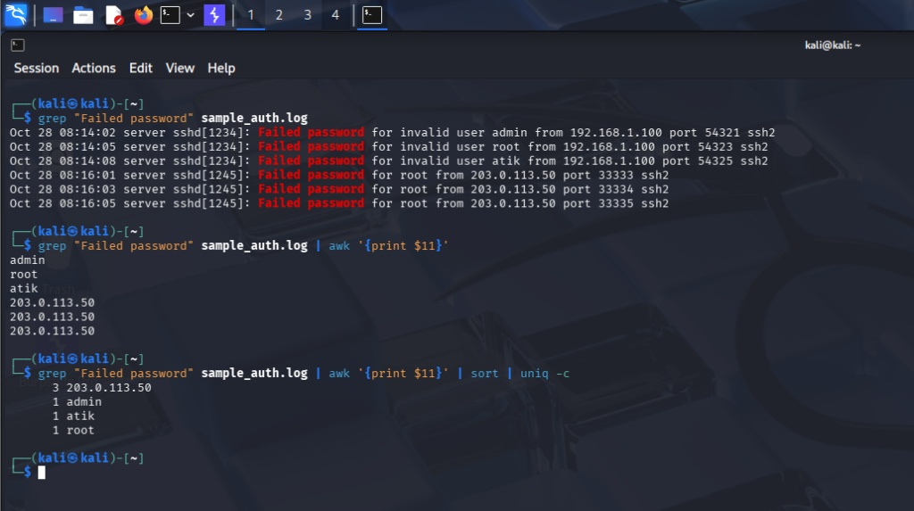

# Day 2: Linux Authentication Log Analysis

## Objective

Analyze Linux authentication logs (`auth.log`) using native command-line tools to identify SSH brute-force attacks and extract malicious IP addresses.

## Tools Used

- **`grep`:** To filter log files for specific keywords (e.g., `"Failed password"`).
- **`awk`:** To parse log lines and extract specific data fields.
- **`sort` and `uniq`:** To group and count the frequency of attacks.

## Investigation Steps & Findings

I created a sample authentication log containing simulated SSH traffic. To identify potential attackers, I chained Linux commands to filter the noise and count failed login attempts per IP address.

### The Command Executed

```bash
grep "Failed password" sample_auth.log | awk '{print $11}' | sort | uniq -c
```

### Terminal Screenshot




### The Results

**Analyst Conclusion**

- The IP address `203.0.113.50` attempted to log in three times.
- **Recommendation:** Investigate the identified IP addresses for brute-force behavior. If confirmed, consider blocking them at the firewall level using `iptables` or adding them to an automated ban list via Fail2Ban.

## Lessons Learned & Recruiter Notes

### 1. Dynamic Log Structures

While analyzing my terminal output, I noticed that `awk '{print $11}'` successfully extracted the IP address from some log entries but returned usernames (`admin`, `atik`, `root`) for others.

### 2. Why This Happened

The SSH daemon can generate log messages with different structures depending on the authentication scenario. When a username does not exist on the system, the log message may include the words `invalid user`. This additional text shifts the IP address from the 11th field to the 13th field.

### 3. SOC Application

This was an important lesson in log parsing. It demonstrated that analysts cannot blindly rely on static field extraction.

When writing SIEM parsing rules in tools such as Splunk or Wazuh, analysts must account for variations in log formats to ensure that critical information, such as source IP addresses, is extracted reliably.

**Key Takeaway:** Reliable log parsing is essential for accurate threat detection and effective incident response.

## The Advanced Solution

Instead of relying on a fixed field number, extract the IP address following the word `from`:

```bash
grep "Failed password" sample_auth.log |
awk '{for (i=1; i<=NF; i++) if ($i=="from") print $(i+1)}' |
sort | uniq -c
```

**Note:** The IP address `203.0.113.50` belongs to a documentation-only IP range and is suitable for simulated lab logs.