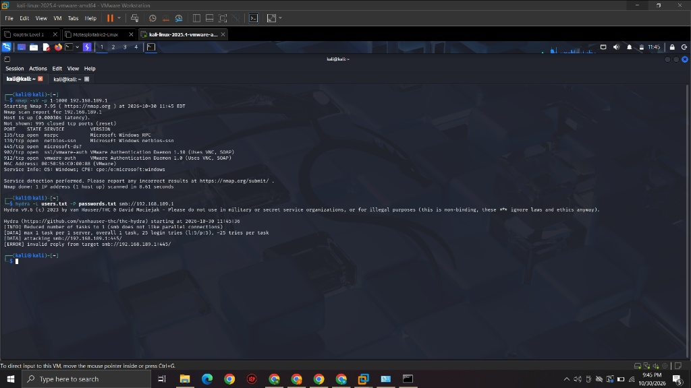
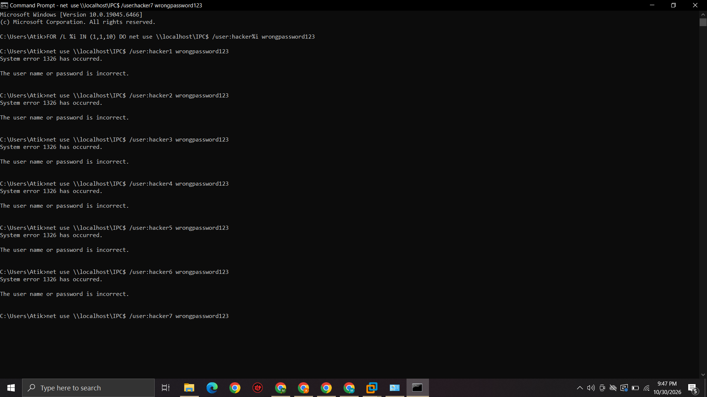

# Day 4: Red Team Operations & Attack Simulation

## Objective
Simulate real-world adversary behavior against the monitored Windows endpoint to generate malicious telemetry (logs) for SIEM detection rule development.

## Attack 1: Network Reconnaissance (Discovery)

To identify attack vectors, I utilized Kali Linux to perform an aggressive Nmap port scan against the target Windows machine across the VMware network.

**Command Executed:**
```bash
nmap -sV -p 1-1000 192.168.189.1
```

**Results:**

Successfully identified open ports including RPC (135), NetBIOS (139), and SMB (445).



## Attack 2: SMB Brute-Force Simulation (Credential Access)

After identifying SMB (Port 445) as open, I attempted a brute-force attack using Hydra. Because modern Windows 10/11 environments often drop raw Hydra SMB authentication requests, I pivoted to a local batch loop to accurately simulate rapid authentication failures and generate high-fidelity Event ID 4625 logs.

**Command Executed:**
```cmd
FOR /L %i IN (1,1,10) DO net use \\localhost\IPC$ /user:hacker%i wrongpassword123
```

**Results:**

Generated a rapid sequence of System Error 1326 (Logon Failure) alerts.



## Attack 3: Malicious PowerShell (Execution & Defense Evasion)

To test Sysmon's process creation monitoring (Event ID 1), I executed a silent PowerShell payload designed to bypass execution policies and enumerate system privileges without triggering standard Windows Defender alerts.

**Command Executed:**
```cmd
powershell.exe -NoProfile -WindowStyle Hidden -ExecutionPolicy Bypass -Command "net user; net localgroup administrators; whoami /priv"
```

*Result: Command executed silently in the background, simulating a post-exploitation discovery script.*

## 🧠 Lessons Learned & Recruiter Notes

- **Network Isolation:** During the Nmap phase, I encountered blocked traffic due to VMware's virtual network adapters (VMnet8) and the host's Windows Defender Firewall. I learned how to temporarily modify firewall rules to allow penetration testing traffic to reach the target endpoint.
- **Adversary Adaptation:** When the Hydra attack failed due to protocol mismatching, I successfully adapted by scripting a native Windows `FOR` loop to achieve the same objective: generating rapid authentication failures to test SIEM alerting.