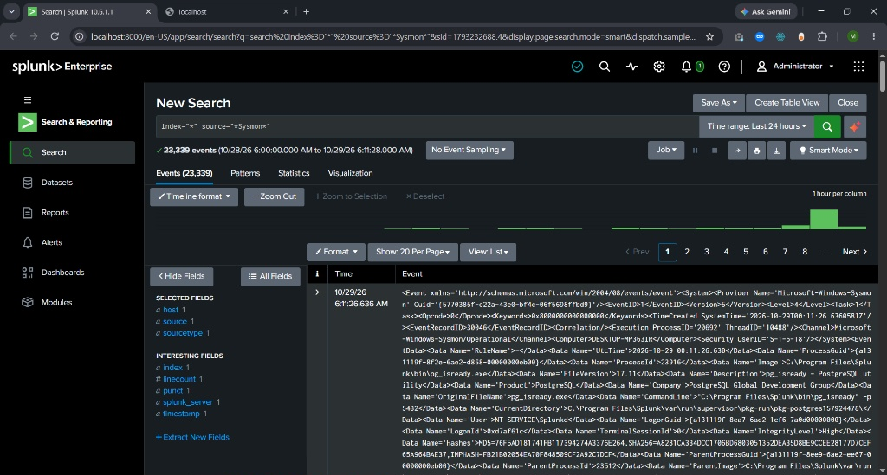

# Day 3: Enterprise SIEM Deployment (Splunk)

## Objective
Deploy a corporate-grade Security Information and Event Management (SIEM) system to aggregate, normalize, and analyze local endpoint logs, specifically focusing on advanced process creation.

## Architecture & Configuration
To simulate a real-world SOC environment within hardware constraints (8GB RAM), I deployed **Splunk Enterprise** directly on the Windows host machine.

I configured Splunk Data Inputs to ingest two critical log sources:

1. **Windows Security Logs:** To monitor authentication events (Event IDs 4624, 4625).
2. **Sysmon Operational Logs:** To monitor advanced process creation and command-line execution (Event ID 1).

## Verification
I ran the following Search Processing Language (SPL) query to verify successful data ingestion:

```spl
index="*" source="*Sysmon*"
```

**Results:**



## 🧠 Lessons Learned & Recruiter Notes (Troubleshooting Log Ingestion)

During this deployment, I encountered a major issue where Splunk was reporting 0 Sysmon events. I successfully isolated and remediated the problem using the following steps:

### 1. Bypassing the Splunk GUI Limitations

The Splunk web interface failed to recognize the deeply nested Sysmon log channel. To fix this, I opened Notepad as Administrator and manually edited the backend configuration file located at:

`C:\Program Files\Splunk\etc\system\local\inputs.conf`

I appended the following configuration block to force Splunk to read the logs and ingest historical data:

```ini
[WinEventLog://Microsoft-Windows-Sysmon/Operational]
disabled = 0
renderXml = 1
current_only = 0
start_from = oldest
```

### 2. Applying an Enterprise Sysmon Configuration

Even after fixing Splunk, no logs appeared because the default Windows Sysmon installation runs without a rule set, meaning it was not generating any Event ID 1 logs.

- I downloaded the industry-standard **SwiftOnSecurity** configuration file from:
  https://raw.githubusercontent.com/SwiftOnSecurity/sysmon-config/master/sysmonconfig-export.xml

- I opened an elevated Command Prompt and pushed the configuration update to the Sysmon service using:

```cmd
sysmon64.exe -c sysmonconfig.xml
```

### 3. Service Restart & Success

After generating new process creation events via PowerShell, I restarted the Splunk server controls. The SIEM successfully ingested over **23,000 Sysmon events**, proving that both the Windows event generation and the Splunk log parsing were functioning correctly.