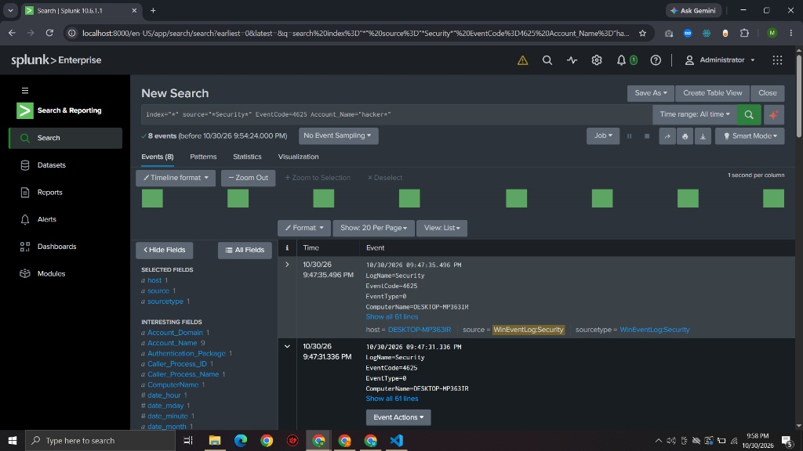
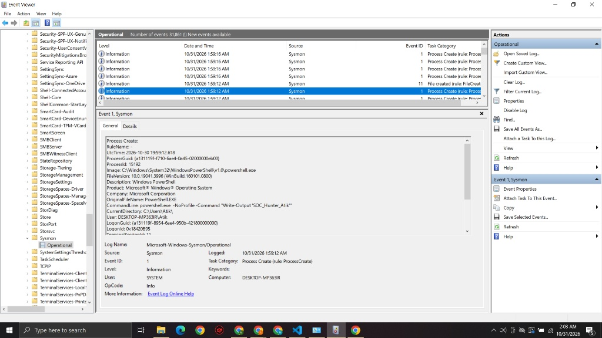

# Day 5: Threat Hunting & Detection Engineering

## Objective
Use Splunk Search Processing Language (SPL) to investigate endpoint telemetry, identify adversary behavior, and map findings to the MITRE ATT&CK framework.

---

## 1. SMB Brute-Force Detection

### MITRE ATT&CK Mapping
- **Tactic:** Credential Access (TA0006)
- **Technique:** Brute Force (T1110)
- **Sub-technique:** Password Guessing (T1110.001)

### The Hunt
To identify rapid authentication failures indicative of a brute-force attack, I queried the Windows Security Event logs for Event ID 4625 (Logon Failure), filtering for the known adversary naming convention used in the attack simulation.

**SPL Query Executed:**

```spl
index="*" source="*Security*" EventCode=4625 Account_Name="hacker*"
```

### Analysis & Findings

- **Log Source:** `WinEventLog:Security`
- **Event ID:** 4625 (An account failed to log on)
- **Telemetry Captured:** The SIEM successfully ingested a rapid succession of failed login attempts targeting the `localhost\IPC$` share. The logs revealed the attacker utilizing a sequential naming convention (`hacker1`, `hacker2`, etc.) and triggering System Error 1326 (Logon Failure).
- **Evidence:**



---

## 2. PowerShell Process Detection

### MITRE ATT&CK Mapping

- **Tactic:** Execution (TA0002)
- **Technique:** Command and Scripting Interpreter (T1059)
- **Sub-technique:** PowerShell (T1059.001)

### The Hunt

To verify Sysmon telemetry ingestion for advanced process creation, I executed a PowerShell tracer payload (`Write-Output 'SOC_Hunter_Atik'`). Because raw Sysmon XML data sometimes bypasses default Splunk field extractions for `EventCode` and `CommandLine`, I utilized a broad text-based SPL query to isolate the execution and confirm pipeline integrity.

**SPL Query Executed:**

```spl
index=* "SOC_Hunter_Atik"
```

### Analysis & Findings

- **Log Source:** `Microsoft-Windows-Sysmon/Operational`
- **Event ID:** 1 (Process Creation)
- **Telemetry Captured:** The SIEM successfully indexed the PowerShell process execution. The raw XML payload confirmed the `Image` as `powershell.exe` and accurately captured the custom command-line arguments.
- **Evidence:**



---

## 3. 🧠 Lessons Learned & Detection Engineering

- **SIEM Ingestion Troubleshooting:** When strict SPL queries (`EventCode=1 CommandLine="..."`) failed to return results, I successfully verified the telemetry pipeline by cross-referencing the Windows Event Viewer source-of-truth and pivoting to raw text SPL searches. This proved the events were being forwarded and indexed correctly, but required custom field extractions for optimal querying.

- **Sysmon Configuration & Tuning:** While deploying the industry-standard SwiftOnSecurity Sysmon configuration, I learned how enterprise environments filter out noisy, interactive administrative commands (like manual `net.exe` executions) to prevent SIEM log bloat. Effective detection engineering requires monitoring anomalous *parent-child* process relationships rather than isolating individual interactive commands.

- **Proposed Detection Rules (Alerting):** To automate detection in a live SOC environment, alerts should be configured to trigger when:
  1. `EventCode=4625` occurs more than 5 times from a single source IP within a 1-minute time window.
  2. `powershell.exe` is spawned by an unusual parent process (e.g., `winword.exe` or `excel.exe`) accompanied by hidden window flags (`-WindowStyle Hidden`).