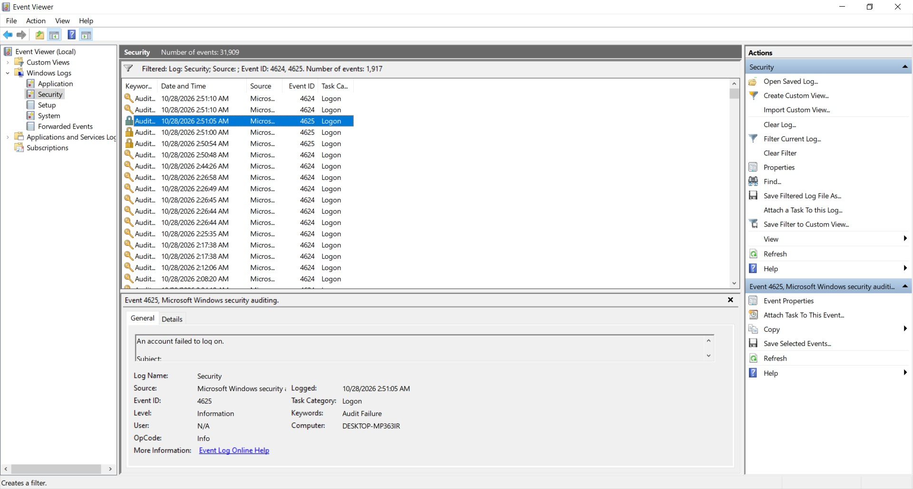
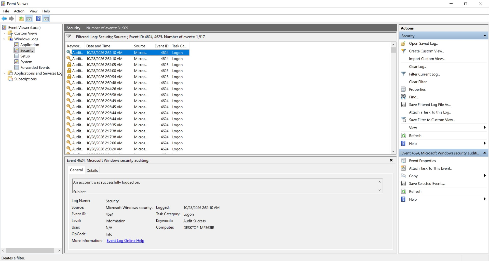
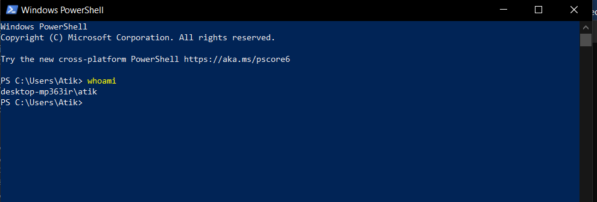

# Day 1: Windows Event Log Analysis

## Objective
Analyze local Windows security logs to identify authentication attempts and process creation, mapping these to real-world SOC monitoring tasks.

## 1. Event ID 4625: Failed Logon
**What this is:** This event generates every time a user fails to log into the system.
**Why SOC monitors this:** A high volume of 4625 events in a short time indicates a Brute Force attack (MITRE ATT&CK T1110).

**My Findings:**

*   **Account Name targeted:** atik
*   **Failure Reason:** Unknown user name or bad password.

## 2. Event ID 4624: Successful Logon
**What this is:** This event generates when a user successfully authenticates.
**Why SOC monitors this:** To track who is accessing the system and how.

**My Findings:**

*   **Logon Type:** 2 (Interactive / Physical Keyboard)

## 3. Sysmon & Process Creation
**What this is:** Sysmon monitors and logs system activity to the Windows event log. It provides detailed information about process creation (Event ID 1).
**Why SOC monitors this:** Monitoring processes helps detect malicious commands.

**My Findings:**

*   **Process Executed:** `whoami`
*   **User Context:** `desktop-mp363ir\atik`

## 🧠 Lessons Learned & Recruiter Notes
*   **Logon Types Matter:** I learned that tracking Event ID 4624 isn't just about knowing *who* logged in, but *how*. A Logon Type 2 (physical keyboard) is normal, but a Logon Type 3 (network) from an unknown IP is a critical incident.
*   **The Power of Sysmon:** Default Windows logging misses a lot of command-line execution. Installing Sysmon allowed me to capture post-exploitation discovery commands like `whoami`, which attackers frequently use immediately after gaining a shell.